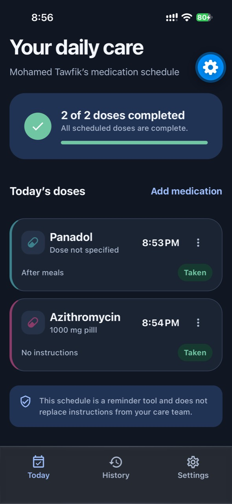
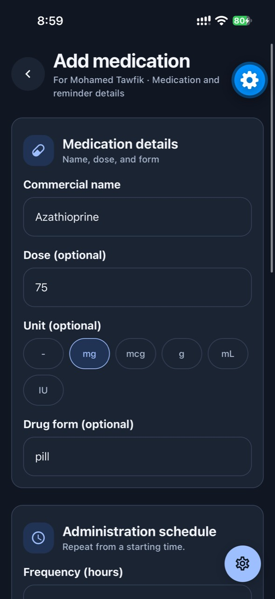
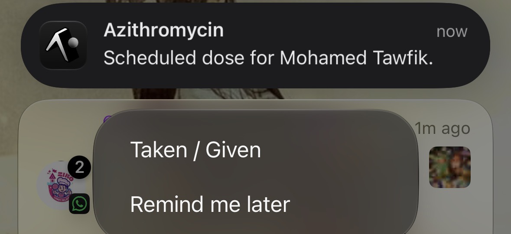

# CareDose

**Medication reminders for you and the people you care for.**


CareDose is a mobile portfolio project built around a common caregiving problem: keeping several medication schedules straight and knowing what has already been taken. It puts the day’s doses, reminders, and recent history in one place, with a separate schedule for each person.

## ✨ Key features

- 🗓️ **Flexible schedules** — set a start time, repeat interval, and treatment duration, with optional dose and care notes.
- 🔔 **Local reminders** — receive scheduled notifications offline and choose **Taken / Given** or **Remind me later**.
- 👥 **Patient profiles** — switch between personal and family schedules under one account.
- 📊 **Daily progress and history** — see what’s due and review recent taken, late, missed, and snoozed doses.
- ☁️ **Offline edits and sync** — save changes locally, then retry Supabase sync when connected.
- 🌙 **Display preferences** — choose a light, dark, or system theme, plus a preferred clock format.

## 📱 UI showcase

| Daily schedule | Add medication | Lock-screen reminder |
| :---: | :---: | :---: |
|  |  |  |

## 🧩 Architecture

Expo Router screens handle navigation and presentation. React Context providers coordinate account, patient, medication, and reminder state. Storage, sync, and notification scheduling live in separate service modules.

- **Device scheduling.** CareDose hands scheduled notifications to iOS or Android, so delivery does not require the app to stay open or online. Long schedules use a rolling queue that refills when the app opens.
- **Local-first writes.** Custom native builds store care records and pending edits in SQLCipher. Supabase Auth identifies the account, and Postgres row-level security limits cloud records to their owner. Conflicting edits are flagged and the pending local edit is preserved.

## ▶️ Run locally

This repository is the portfolio showcase. Running the app requires access to the private application source, Node.js, and a configured Supabase test project.

```bash
git clone "$CAREDOSE_SOURCE_URL" caredose
cd caredose
npm ci
npm start
```

Set `CAREDOSE_SOURCE_URL` to the private source URL and configure `.env.local` from the source repository’s example before starting. Press **a** for an Android emulator or **i** for an iOS Simulator on macOS. Use a custom development build to test SQLCipher and a physical device to verify notification delivery.
