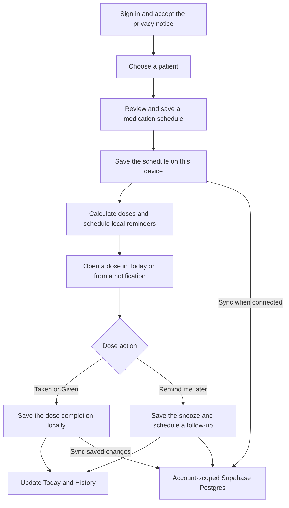

# CareDose

**Medication reminders for you and the people you care for.**

Keeping track of medication gets harder when several doses fall on the same day or one person manages schedules for the whole family. CareDose gives each patient a separate schedule, shows what is due or already taken, and lets the phone deliver reminders offline once they are scheduled.

**Project status** · Personal portfolio project and fictional-data beta. The application source is private.

[Screenshots](#screenshots) · [Product workflow](#product-workflow) · [Architecture and integrations](#architecture-and-integrations) · [Development and verification](#development-and-verification) · [Beta status](#beta-status)

## Screenshots

iPhone beta captures. Select any image to open it at full size. The lock-screen capture shows the named reminder and its two actions.

| Today | Snoozed dose | Dose history |
| :---: | :---: | :---: |
|  |  |  |

**Lock-screen reminder**

| Sign in | Select a patient | Add medication |
| :---: | :---: | :---: |
|  |  |  |

| Set the schedule | Review before saving | Medication details |
| :---: | :---: | :---: |
|  |  |  |

## Product workflow

1. **Set up care.** Sign in, review the privacy notice and choose the personal workspace. The welcome screen remembers completion on that device. The account holder gets a profile and can add or switch between profiles for the people they care for.
2. **Build a schedule.** Enter the medication name, start time, repeat interval and duration. Add a dose, unit, form, instructions or notes as needed. Review the summary before saving. An existing schedule can be edited, paused, resumed or removed.
3. **Respond to a dose.** Today shows each scheduled occurrence and the patient's progress. Open a due dose in the app or use **Taken / Given** or **Remind me later** from a notification. A snooze keeps the original occurrence and schedules a follow-up.
4. **Review what happened.** History groups the patient's last seven days by date and distinguishes on-time, late, missed and snoozed doses. Removing a medication or patient preserves recorded history. Settings control the theme, clock format, reminder sound and snooze delay, and provide a test reminder.

## Architecture and integrations

| Layer | Implementation |
| --- | --- |
| App and navigation | Expo SDK 58, React Native, TypeScript and Expo Router. React Context providers coordinate session, patients, medication schedules, preferences, privacy and diagnostics. Storage, reminder planning and sync are separate from the screens. |
| Interface | Shared controls and theme tokens keep Today, History, Settings and the care forms consistent. Controls expose accessible labels and states. Motion follows system preferences, and the iOS glass treatment has an opaque fallback for unsupported devices or reduced transparency. |
| Identity | Supabase Auth handles email and password, signup verification codes and session refresh. Email and password changes require reauthentication in an isolated session. Google and Apple sign-in paths depend on provider configuration. |
| On-device data | Custom native builds use Expo SQLite with SQLCipher and keep the database key in Expo SecureStore. Records are scoped to the signed-in account. Expo Go and web use unencrypted storage for fictional-data previews. |
| Cloud sync | The sync implementation uses Supabase Postgres for patient profiles, medication schedules and dose history. Row-level security limits access to the owner. Sync requires current privacy consent, and importing existing on-device records is a separate choice. |
| Notifications | Expo Notifications schedules reminders on each device and registers dose actions. Android has audible and silent channels. Today and Settings surface scheduling errors, permission problems and the current coverage window. |
| Diagnostics and feedback | Optional Sentry JavaScript error reporting starts off. Filters exclude care records, names and email addresses from diagnostic payloads. A separate Supabase beta-event path is feature-flagged. The in-app problem report opens a draft for the user to review and send. |

### Handling failures and concurrent changes

- **Offline edits.** Writes go to local storage first. Pending edits survive reopening and retry while CareDose is active. Sync merges edits to different records and checks the server revision before writing. Competing edits to the same record leave the local change intact and surface a conflict. A manual conflict-resolution screen is still pending.
- **Reminder coverage.** CareDose plans from each schedule's start time, repeat interval and end date. The rolling queue holds up to 60 pending notifications, including a prompt to reopen the app when the schedule exceeds that window. Returning to the app refills coverage. A dose action is tied to its original occurrence to prevent duplicate completion.
- **Recovery and account changes.** CareDose validates stored records before it loads schedules or creates reminders. On a failed read, it preserves the data and offers a retry. Writes and reminder updates run in order. Account checks reject stale work, and sign-out clears scheduled and displayed reminders.

### Privacy controls

Care screens require explicit, versioned consent. Withdrawal pauses care access and sync, cancels scheduled reminders and turns off diagnostics while retaining care records. Local clearing is scoped to the current account and device. Self-service account deletion uses an authenticated Supabase Edge Function to verify recent sign-in, revoke sessions and soft-delete the account. The care-sync schema includes server-side cleanup for that account's synced care data. The History screen shows seven days, while stored history is kept until deletion.

## Development and verification

1. **Develop against a test environment.** With authorized access to the private app checkout, run `npm ci` to install from the lockfile and apply tracked dependency patches. Configure a Supabase test project, then use `npm start` for Expo development. A custom native build is needed to verify SQLCipher and release-build notification behavior.
2. **Run automated checks.** Node's test runner, TypeScript and ESLint cover changes before a build. Regression cases include reminder planning, duplicate dose actions, account switching, sign-out cleanup, consent, storage recovery and simulated offline sync.
3. **Build and inspect the artifact.** Android work used isolated clean builds, APK signature and hash verification, MobSF scans, and native-library and dependency review. iOS uses Expo Application Services (EAS) profiles for internal device builds, Simulator builds and production signing.
4. **Verify on devices.** The test plan records the build, device and outcome for permissions, locked-screen delivery, snoozing, restart and battery behavior, migration, accessibility and account isolation.

## Beta status

| Area | Evidence and open work |
| --- | --- |
| Automated validation | The November 4 onboarding checkpoint recorded 72 passing tests and a passing TypeScript check. A separate sync regression simulated an offline edit, reopened storage and verified upload after reconnecting. |
| Android | Earlier signed builds installed and launched on a Galaxy A55. Android build and security review evidence applies to those artifacts. Reminder delivery under reboot and battery restrictions, encrypted migration and TalkBack still need device verification. |
| iOS | The screenshots show the iPhone preview. The EAS profiles are configured. A signed distribution build and the full iPhone checklist, including VoiceOver and lock-screen behavior, still need verification. |
| Backend | The care-sync migration was applied. Live database checks confirmed row-level security, blocked anonymous access and checked that signed-in users could not reassign ownership. The deployed deletion endpoint rejected unauthenticated requests. Authenticated deletion, two-device sync and offline recovery on a phone still need end-to-end validation. |
| Release | Policy review and store distribution are pending. Enterprise is marked **Coming soon**. |

CareDose supports an existing care plan. Follow the medication and dosing instructions provided by your care team.
