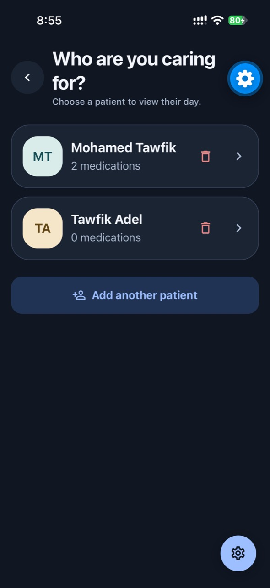
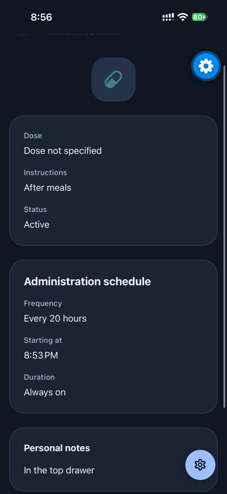
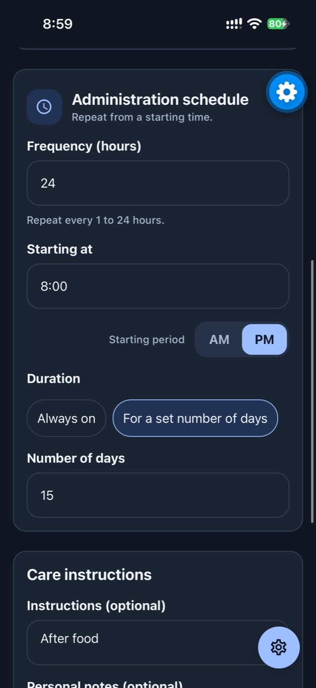
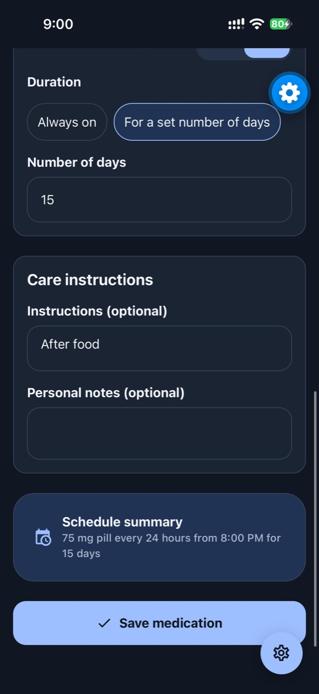
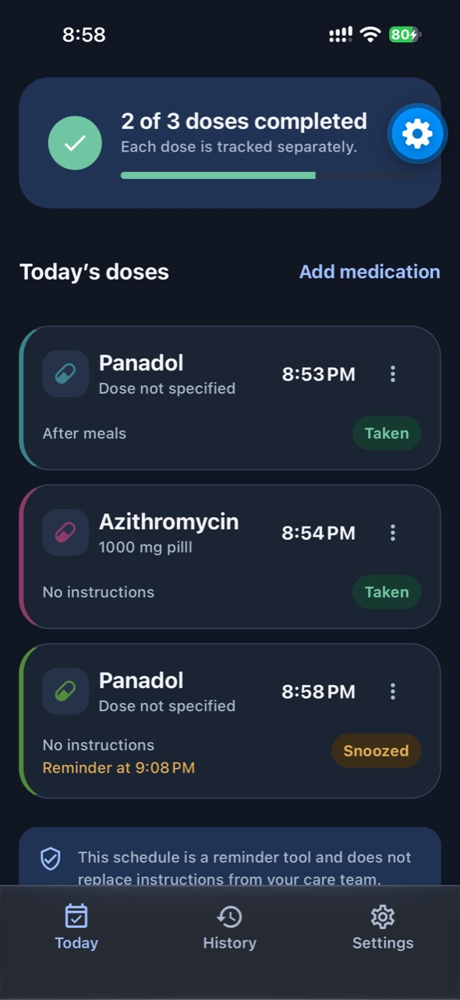
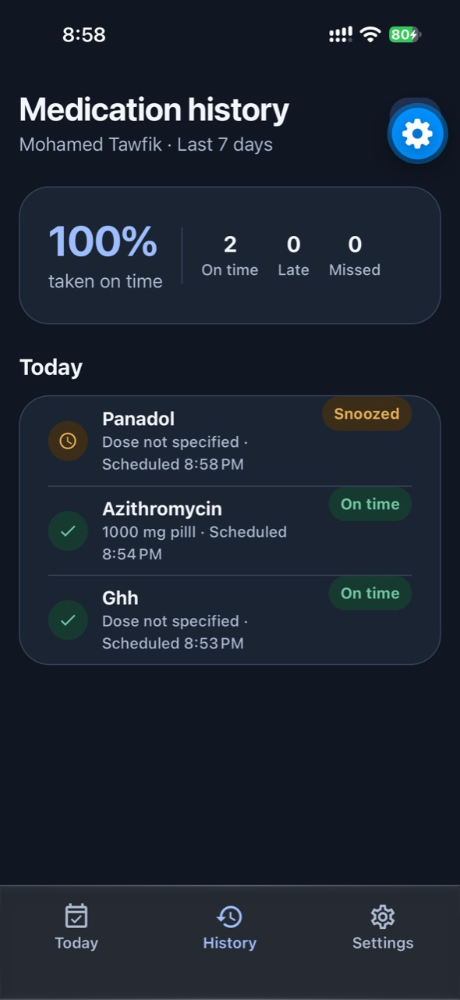
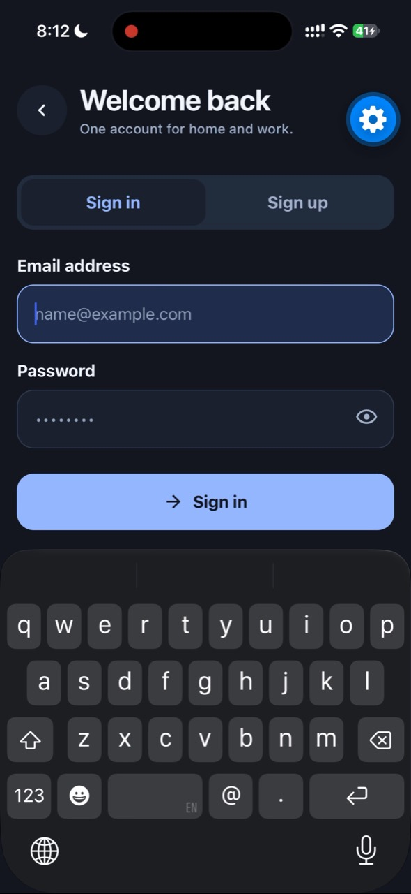
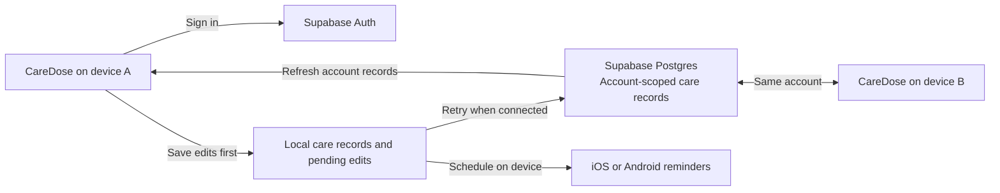

# CareDose

**A medication reminder app for individuals and family caregivers.** Set up a schedule for each patient, see what is due today, and record when a dose was taken, given, missed, or snoozed.

This public showcase contains product documentation and iPhone beta screenshots. The application source and build files are private.

[Feature tour](#feature-tour) · [Supabase integration](#supabase-integration) · [Beta status](#beta-status)

## Feature tour

| Feature | iPhone beta screenshot |
| --- | --- |
| **Today and dose progress** See the active patient's scheduled doses and how many are complete. Cards show the scheduled time, dose instructions, and the current status. Open a dose or add a medication from the same screen. |  |
| **Patient profiles** Keep separate medication schedules for yourself and the people you care for. Add or remove profiles and choose whose day to view. |  |
| **Medication details** Review a medication's dose, instructions, active or paused status, repeat interval, start time, duration, and notes. Medication management also supports editing, pausing, and removing an entry. |  |
| **Add a medication** Enter the medication name and optionally record the dose, unit, and form. These fields describe the caregiver's existing plan. |  |
| **Repeat schedule** Pick a start time and a repeat interval from one to 24 hours. The schedule can run indefinitely or stop after a set number of days. |  |
| **Instructions, notes, and review** Add optional care instructions and personal notes. Check the schedule summary before saving. |  |
| **Local reminders and quick actions** The phone schedules and delivers reminders, including when offline. On the iPhone shown here, the notification displays the medication and patient names and offers **Taken / Given** and **Remind me later**. Tapping the reminder opens the dose screen. Lock-screen visibility follows device preview settings. |  |
| **Snooze** Postpone a dose reminder and see the updated reminder time on Today. The default delay can be changed in Settings. |  |
| **Dose history** Review the active patient's last seven days. The history distinguishes on-time, late, missed, and snoozed doses and summarizes on-time completion. |  |
| **Sign-in and onboarding** Create an account, verify an email address, or sign back in with email and password. CareDose remembers welcome completion on the device. Apple and Google sign-in depend on provider configuration and platform support. |  |

### Settings and privacy

- Set the appearance to System, Light, or Dark, and choose system, 12-hour, or 24-hour time display. Supported transitions respect Reduce Motion.
- Turn reminders and sound on or off, set the default snooze delay, and send a test reminder. Reminder preferences and operating-system permissions are set on each device.
- Manage account email and password, sign out, and review privacy and terms. Privacy controls cover consent, withdrawal, clearing local care data, and requesting account deletion.
- Choose whether to share optional diagnostics. Structured diagnostics can go to Sentry, and usage metrics can go to Supabase when configured. The diagnostic payloads exclude care records.
- Review a support email before sending it from the device's mail app.

## Supabase integration

CareDose uses **Supabase Auth** for identity and **Supabase Postgres** to sync care records between devices signed into the same account. The synced record contains patient profiles, medications and schedules, instructions and notes, and dose history. Local notification scheduling and delivery stay on each phone.

| Area | How it works |
| --- | --- |
| **Account isolation** | Each cloud record belongs to a Supabase user ID. Postgres row-level security scopes authenticated access to the current account. Anonymous access and client changes to record ownership are blocked. |
| **Offline edits** | The app saves changes locally first. It retries upload while open and checks again when brought to the foreground. A device receives another device's changes when it next syncs. |
| **Concurrent edits** | CareDose compares the last synced records, local edits, and current cloud records. It can merge edits to different records. Competing edits to the same record are preserved locally and flagged. The beta has no in-app conflict resolution yet. |
| **Consent and import** | The app asks for cloud sync consent. Uploading existing records already saved for that account on the device is a separate choice. |
| **Local storage** | Custom native builds use SQLCipher with a key kept in the device's secure storage. Expo Go and web are preview environments for fictional data and do not use the native encrypted database. |
| **Account deletion** | The backend is configured to remove the synced care record when the account is soft-deleted. The app also offers a separate local data clearing action. |

## Beta status

CareDose is built with React Native, Expo, Expo Router, and TypeScript. The screenshots show the iPhone beta, including a delivered local reminder and recorded dose outcomes. The Supabase schema is deployed and its access rules have been checked. Full two-device sync, an offline edit through an Expo Go restart and reconnection, and account deletion still need end-to-end verification.

Enterprise workspace features are marked **Coming soon**. Reminder delivery depends on device permissions and operating-system behavior. CareDose helps track an existing medication plan and does not replace instructions from a care team.
